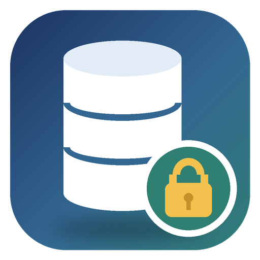
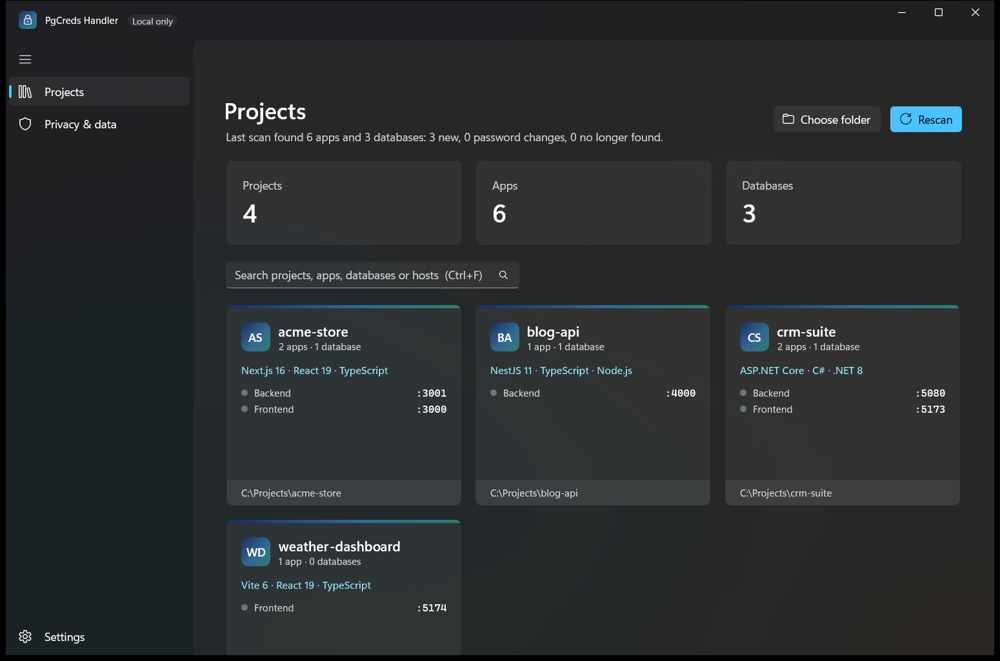

<div align="center">



# PgCreds Handler

**Every project on your PC, with its ports, database connections and stack, in one window.**
<br />Private, offline and open source. Nothing ever leaves your PC.

[](https://github.com/shahzaibali0/DataBaseCredsHandler/actions/workflows/ci.yml)


[](LICENSE)



</div>

---

## ⚡ Install in one line

Open **PowerShell** and paste:

```powershell
irm https://raw.githubusercontent.com/shahzaibali0/DataBaseCredsHandler/main/install.ps1 | iex
```

That's it. The app is downloaded, added to your Start menu and opened. No admin rights, no .NET to install.
Run the same line again any time to **update**.

<details>
<summary>Other ways to install</summary>

- **Download it:** get `PgCredsHandler.exe` from [Releases](https://github.com/shahzaibali0/DataBaseCredsHandler/releases) and double-click it.
  Windows may show a SmartScreen warning because the file isn't code-signed yet: choose **More info → Run anyway**.
- **From source:** `git clone https://github.com/shahzaibali0/DataBaseCredsHandler.git`, then double-click **`start.cmd`** in the folder.
  Needs the [.NET SDK](https://dotnet.microsoft.com/download) 8 or newer.

</details>

---

## 🤔 Why

You have many projects, each with its own database and dev servers, and the details are buried in `.env`, `docker-compose.yml` and `appsettings.json` files. Every time you open one in DBeaver or pgAdmin, you dig through files for the host, port, user and password.

PgCreds Handler finds all of it for you, once, and keeps it one click away.

## ✨ Features

| | |
|---|---|
| 🔍 **One-click scan** | Looks through your drives (or the folders you choose) and skips Windows, Program Files, `node_modules`, `.git` and other non-project folders. |
| 🗂️ **One card per project** | Each git repository becomes a card with its backend, frontend and databases. |
| 🟢 **Live status** | A green dot shows which dev servers and local databases are running right now. |
| 🔌 **Ports** | Every app's local address (`http://localhost:3001`) with an **Open** button, read from its dev script, `.env` or `launchSettings.json`. |
| 🐘 **Database connections** | Host, port, database, user and password (masked, with 👁 to show and a Copy button). |
| 🚀 **Open in your DB tool** | **DBeaver** opens already connected, **pgAdmin** gets the server added for you, **DbVisualizer** opens with the URL copied. Buttons light up only for tools you have installed. |
| 🧱 **Stack & key packages** | Next.js 16 · React 19 · TypeScript, or ASP.NET Core · .NET 8, plus the important packages by purpose (database, auth, payments, UI…). |
| 🔒 **Stays on your PC** | Passwords live in Windows Credential Manager, never in a file. No account, no server, no telemetry. |
| 🪟 **Always there** | Lives in the system tray, starts with Windows, rescans quietly in the background. |

<div align="center">

</div>

## 📁 What it reads

- **`.env` files**: `DATABASE_URL`-style URLs and `DB_HOST` / `DB_PORT` / `DB_NAME` / `DB_USER` / `DB_PASSWORD` groups, including `${VAR}` references.
- **`docker-compose.yml`**: Postgres services, with the published port (`"5433:5432"` → `localhost:5433`).
- **`appsettings*.json` and .NET User Secrets**: .NET connection strings, including the dev connection string kept in User Secrets (`%APPDATA%\Microsoft\UserSecrets`) for projects that use them. Only connection strings are read.
- **`package.json` and `.csproj`**: the framework, dev-server port and package names, for the stack.

It reads **only** database connection details, ports and package names. It never reads or stores other secrets from your `.env` files (API keys, tokens). Template values in example files (`USER@HOST:PORT/DATABASE`) are ignored.

## 🔒 Your data stays on your PC

**PgCreds Handler never sends your data anywhere.** It has no server, no account, no telemetry and no update check.

| What | Where |
| --- | --- |
| Projects and connection details (no passwords) | `%APPDATA%\PgCredsHandler\` |
| Passwords | Windows Credential Manager (`PgCredsHandler:<id>`), never in a file |

Check it yourself:

- ✅ An automated test ([`PrivacyTests.cs`](tests/PgCredsHandler.Tests/PrivacyTests.cs)) fails the build if the code that scans, stores or shows your data ever uses a networking library.
- ✅ The only connections the app makes are to **your own PC** (`localhost`) to see whether a server is running, and to a database **you** open in a DB tool. A remote server is never contacted for status.
- ✅ It's open source: search the code for `HttpClient` or `Socket`.

<details>
<summary>🧹 Uninstall or start over</summary>

```powershell
& ([scriptblock]::Create((irm https://raw.githubusercontent.com/shahzaibali0/DataBaseCredsHandler/main/install.ps1))) -Uninstall
```

That removes the app, its Start menu shortcut and its startup entry. To also delete your saved list:

1. Delete the folder `%APPDATA%\PgCredsHandler`.
2. Open **Credential Manager** → **Windows Credentials** and remove the entries starting with `PgCredsHandler:`.

</details>

## 🗺️ Roadmap

- [x] One-click scan, projects grid, project window
- [x] Ports, live status, stack and key packages
- [x] Open in DBeaver / pgAdmin / DbVisualizer
- [x] Tray, start with Windows, one-line install
- [ ] MySQL, SQL Server and MongoDB, not just Postgres
- [ ] Django, Laravel, Rails, Prisma and Spring config files
- [ ] Open a project in VS Code, Explorer or a terminal; show its git branch
- [ ] Pin favourite projects

## 🤝 Contributing

Issues and pull requests are welcome.

```powershell
git clone https://github.com/shahzaibali0/DataBaseCredsHandler.git
cd DataBaseCredsHandler
git config core.hooksPath .githooks   # turns on the privacy check
dotnet test                           # 100+ tests
.\start.cmd                           # build and run
```

<details>
<summary>Project layout and rules</summary>

```
src/
  PgCredsHandler.Core          models, parsing helpers, merge rules (no file or network access)
  PgCredsHandler.Scanner       finds config files and reads connections, apps, ports and stack
  PgCredsHandler.Storage       the JSON data files and Windows Credential Manager
  PgCredsHandler.Integrations  DBeaver, pgAdmin, DbVisualizer and the localhost status check
  PgCredsHandler.Presentation  what each screen shows and does (viewmodels), tested without a window
  PgCredsHandler.App           the WinUI 3 window and pages
tests/
  PgCredsHandler.Tests         xunit tests
```

- **Built with** WinUI 3 (Windows App SDK) on .NET 8, CommunityToolkit.Mvvm, CommunityToolkit.WinUI and WinUIEx. Ships as one self-contained `.exe`.
- **Never commit real data:** no credentials, no `.env` files, no `connections.json`. The privacy check blocks the app's data files, real `.env` files, and any line containing a project name, path, database or host that PgCreds Handler found on your PC.
- **Try it with demo data:** set `PGCREDS_DATA_DIR` to another folder before starting the app, so your real list isn't touched.
- **Design rules, coding style and decisions** are in [.agents/](.agents/README.md). They're written for AI coding agents and work just as well for people.
- **Publishing a release** (maintainers): push a tag such as `v0.1.0`. GitHub Actions builds `PgCredsHandler.exe` and attaches it to the release.

</details>

## 📄 License

[MIT](LICENSE)
